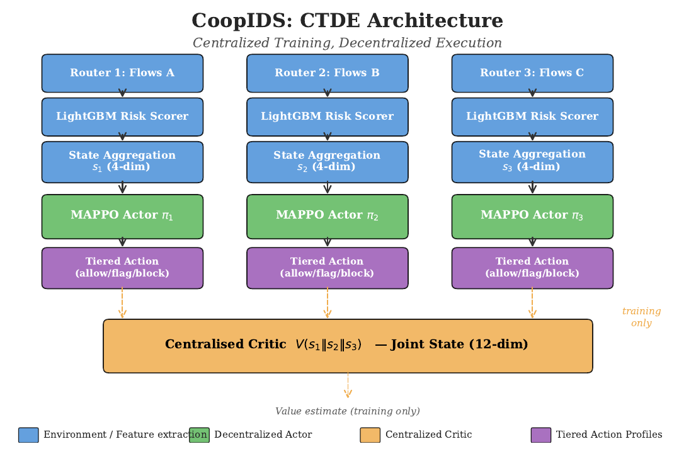
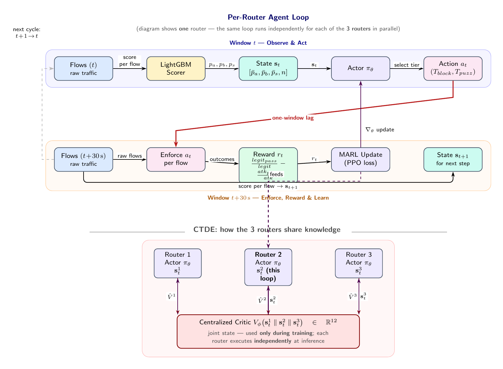

# CoopIDS — Cooperative Multi-Agent RL for DDoS Mitigation at ISP Edge Routers

CoopIDS is a research project that studies whether several cooperating reinforcement-learning agents, placed at different ISP edge routers, can learn to filter DDoS traffic better than a fixed rule. It uses **MAPPO** (Multi-Agent PPO, centralised training / decentralised execution), a pre-trained **LightGBM risk scorer**, and a small set of **tiered defence profiles**. It is evaluated on real cloud traffic (BCCC-cPacket-Cloud-DDoS-2024), including **attack types never seen in training**.

The full write-up is in [report/report.pdf](report/report.pdf). The stage-by-stage lab notebook is [ablation_notes.md](ablation_notes.md), and the detailed design is [ARCHI.md](ARCHI.md).

## Contents

1. [The idea in one minute](#the-idea-in-one-minute)
2. [Key results](#key-results)
3. [How the system works](#how-the-system-works)
4. [Ablation study (S1–S42)](#ablation-study-s1s42)
5. [Repository layout](#repository-layout)
6. [Setup](#setup)
7. [Reproducing the experiments](#reproducing-the-experiments)
8. [Dataset](#dataset)
9. [Main findings](#main-findings)
10. [What is and isn't in this repository](#what-is-and-isnt-in-this-repository)

## The idea in one minute

```
 flows ──► hash(src_ip) % N ──► Router 1 ─┐
                               Router 2 ─┼─► victim machines
                               Router 3 ─┘
              each router = one MARL agent
```

1. Network flows arrive and are assigned to one of N routers (default 3) by hashing the source IP.
2. A **LightGBM risk model** scores every flow: `p_risk = 1 − P(benign)`.
3. Every 30-second window, each agent looks at its local statistics and picks one of **6 tiered profiles** (Passive … Lockdown). A profile is a pair of thresholds that decide, flow by flow, whether to *drop*, send a *CAPTCHA puzzle*, or *forward*.
4. The reward favours forwarding legitimate traffic and stopping attack traffic.
5. A **centralised critic** sees all agents' observations during training only. At run time each agent acts on its own local state (CTDE).

### Architecture

**Overall system (CTDE).** Each router has its own risk scorer, state aggregation, actor and tiered action. The centralised critic sees the joint 12-dim state and is used only during training.



**What one router does, step by step.** Window *t* observes and acts. Window *t+30 s* enforces the action, computes the reward and updates the policy. The bottom panel shows how the three routers share knowledge through the critic.



### Tiered action profiles

| ID | Profile    | T_block | T_puzzle |
|----|------------|---------|----------|
| 0  | Passive    | 1.00    | 1.00     |
| 1  | Light      | 0.90    | 0.60     |
| 2  | Moderate   | 0.80    | 0.40     |
| 3  | Firm       | 0.70    | 0.25     |
| 4  | Aggressive | 0.60    | 0.15     |
| 5  | Lockdown   | 0.50    | 0.10     |

`p_risk ≥ T_block` → drop. `T_puzzle ≤ p_risk < T_block` → CAPTCHA (bots fail ~95% of the time, humans pass ~95%). Otherwise → forward.

Why `1 − P(benign)` and not `P(attack)`? On unseen attacks the model's `P(attack)` collapses, but `P(benign)` stays low for anything abnormal, so `p_risk` keeps separating attack from legitimate traffic.

## Key results

Trained on **Monday only**. Tuesday contains 5 attack types the model has never seen (zero-shot).

| Model | Stage | Monday TPR / FPR | Tuesday TPR | Tuesday FPR | Tuesday F1 |
|-------|-------|------------------|-------------|-------------|------------|
| LightGBM alone (no RL) | – | – | 37.02% | 0.42% | 53.05% |
| MAPPO, tiered (final model) | S27 | 99.5% / 2.9% | 85.78% | 6.01% | 77.14% |
| IPPO, no CTDE | S29 | – | 88.38% | 7.71% | 75.10% |
| MAPPO + sensor retrained on Mon+Tue | S30 | 99.1% / 2.3% | **94.68%** | **1.17%** | **93.83%** |
| MAPPO + end-to-end MLP encoder | S39 | 98.3% / 1.6% | 83.96% | 5.74% | 76.70% |
| MAPPO + raw top-6 flow features | S41 | 98.3% / 2.3% | 85.23% | 5.92% | – |

- **TPR**: share of attack flows stopped. **FPR**: share of legitimate flows wrongly stopped.
- The jump from S27 to S30 changes only the risk scorer, not the policy. That's the main evidence that the **sensor, not the RL policy, limits generalisation**.
- Exact per-run numbers (which differ slightly between seeds and evaluation passes) are in [artifacts/evaluation/](artifacts/evaluation/) and [artifacts/evaluation/comparative_results.txt](artifacts/evaluation/comparative_results.txt).

Plots for every experiment are in [artifacts/plots/](artifacts/plots/) (TPR/FPR comparison, generalisation gap, MAPPO vs IPPO, scalability, action heatmaps, training curves).

## How the system works

| Component | File | Role |
|-----------|------|------|
| Risk scorer | [Risk_Model/train_eval_save_lgbm.py](Risk_Model/train_eval_save_lgbm.py) | 3-class LightGBM (benign / suspicious / attack) on 42 flow features |
| Environment | [src/environment_tiered_v2.py](src/environment_tiered_v2.py) | Replays real flows in 30 s windows, applies the chosen profile, computes reward. Main environment for S27+ |
| MAPPO | [src/mappo.py](src/mappo.py) | Actor per router, shared centralised critic, rollout buffer |
| IPPO / IQL | [src/ippo.py](src/ippo.py), [src/iql.py](src/iql.py) | Baselines: independent PPO (no shared critic) and independent Q-learning |
| FlowEncoder | [src/flow_encoder.py](src/flow_encoder.py) | MLP that replaces LightGBM, trained jointly with the policy (S39) |
| Evaluation | [src/evaluate.py](src/evaluate.py) | Runs trained models on Monday/Tuesday/Thursday/Saturday and writes JSON |
| Config | [config.py](config.py) | Paths, hyperparameters, per-stage output folders |

**State per agent (S27):** 4 numbers: mean `p_attack`, `p_benign`, `p_suspicious` over the window, plus normalised flow count. The centralised critic sees all agents' states concatenated (12-dim for 3 agents).

**Reward:** local, per-window `legit_ratio − attack_ratio` (range −1 to +1).

## Ablation study (S1–S42)

The project is a long sequence of controlled experiments, each changing one thing. Full reasoning and numbers for each are in [ablation_notes.md](ablation_notes.md).

| Stages | What was studied |
|--------|------------------|
| S1–S5 | Single agent: load-only state → raw features → LightGBM risk → IP blocking → CAPTCHA |
| S6–S9 | Multi-agent algorithms: IQL vs IPPO vs MAPPO (S9 is the reference baseline) |
| S10–S22 | State and action-space variants: extended state, 10-action throttle, puzzle cost, entropy, curriculum, asymmetric and counterfactual rewards |
| S23–S25 | Selective puzzle, flagged-IP tables, combined LightGBM |
| S26–S27 | **Tiered action profiles** and `p_risk` routing. This fixed "puzzle dominance" (agents always picking CAPTCHA) |
| S28 | Mixed-density training (Monday + Thursday) |
| S29 | IPPO: does cooperation matter at 3 agents? |
| S30 | Sensor retrained on Mon+Tue: isolates the risk-model effect |
| S31, S37 | 6 agents: IPPO (S31) vs MAPPO (S37) scalability test |
| S32–S36 | Minimal state, shared IP blocklist, victim-based routing |
| S38 | Realistic ECMP 5-tuple routing |
| S39 | End-to-end FlowEncoder instead of LightGBM |
| S40 | Global vs local reward |
| S41 | Raw top-6 flow statistics as agent state |
| S42 | SupCon (contrastive) pre-trained encoder as agent state |

## Repository layout

```
.
├── main.py                 # Pipeline entry point (--stage sNN | eval)
├── config.py               # Paths, hyperparameters, stage output dirs
├── requirements.txt
├── ARCHI.md                # Detailed architecture / design document
├── ablation_notes.md       # Lab notebook for all stages S1–S40 + conclusions
├── Risk_Model/             # LightGBM risk scorer: training, baselines, inference helper
│   └── artifacts/vae/v1/selected_features.json   # the 42 selected features
├── src/
│   ├── mappo.py, ippo.py, iql.py                 # Algorithms
│   ├── environment_*.py                          # Environment versions (tiered v2 is the main one)
│   ├── flow_encoder.py                           # Learnable risk encoder (S39)
│   ├── evaluate.py                               # Multi-model evaluation
│   └── train_sNN.py                              # One training script per ablation stage
├── scripts/                # Evaluation, plotting, analysis and encoder pre-training
│   ├── eval_s41.py, eval_s42.py, eval_static_baseline.py, eval_routing_seeds.py
│   ├── pretrain_supcon_encoder.py, pretrain_threat_encoder.py
│   ├── train_lgbm_combined.py                    # Sensor retrained on Mon+Tue (S30)
│   └── generate_plots.py, analyse_*.py, flow_breakdown.py
├── artifacts/
│   ├── evaluation/         # JSON results for every stage + comparative_results.txt
│   ├── plots/              # Figures used in the report
│   └── encoder/            # Pre-trained encoder reports (weights are gitignored)
├── report/                 # LaTeX paper source, compiled report.pdf, figures, Q&A prep
└── BCC-2024/analyser.ipynb # Dataset exploration notebook
```

## Setup

```bash
python -m venv .venv && source .venv/bin/activate
pip install -r requirements.txt
```

Dependencies: numpy, pandas, scikit-learn, lightgbm, torch, joblib, matplotlib, seaborn, jupyter. Training runs on CPU; a 500-episode run takes roughly 20–25 minutes.

Then download the dataset (see [Dataset](#dataset)) and put the four CSV files in `BCC-2024/`.

## Reproducing the experiments

### 1. Train the risk scorer

```bash
python Risk_Model/train_eval_save_lgbm.py \
    --split-mode day \
    --backend lightgbm \
    --model-bundle-out Risk_Model/artifacts/vae/v1/models/lgbm_bundle_monday.pkl
```

This trains a Monday-only 3-class LightGBM and saves the bundle used by S27 and later. For the S30 "retrained sensor" experiment, also run:

```bash
python scripts/train_lgbm_combined.py
```

### 2. Train a MARL policy

```bash
python main.py --stage s27      # final model: MAPPO + p_risk tiered profiles
```

Weights are written to `artifacts/marl/v1/ablation/<STAGE>/`. Other stages:

| Command | Experiment |
|---------|------------|
| `python main.py --stage s29` | IPPO, no CTDE |
| `python main.py --stage s30` | MAPPO + sensor retrained on Mon+Tue |
| `python main.py --stage s37` | MAPPO with 6 agents |
| `python main.py --stage s39` | MAPPO + end-to-end FlowEncoder |
| `python main.py --stage s40` | MAPPO + global reward |
| `python src/train_s41.py` | Raw top-6 feature state |
| `python src/train_s42.py` | SupCon encoder state (needs `scripts/pretrain_supcon_encoder.py` first) |

`main.py` exposes stages up to S40; S41 and S42 are run directly from their scripts. Any other stage (S11–S38) can be run the same way as `python main.py --stage sNN` or `python src/train_sNN.py`.

### 3. Evaluate

```bash
python main.py --stage eval --tag s27_results                 # all models
python main.py --stage eval --tag my_run --models s27,s29,s30 # selected models
python scripts/eval_s41.py                                    # S41
python scripts/eval_s42.py                                    # S42
```

Results are saved as JSON under `artifacts/evaluation/v1/<tag>/`.

Metrics reported per model and day: **TPR**, **FPR**, **Precision**, **F1** and **Legit ratio** (= 1 − FPR). TPR/FPR are measured at the **flow level**, not the window level.

## Dataset

**BCCC-cPacket-Cloud-DDoS-2024**: real TCP DDoS traffic captured on AWS infrastructure, with 6 victim machines.
Download: https://www.unb.ca/cic/datasets/ddos-2024.html

| File | Flows | Role |
|------|-------|------|
| `Monday_18_Dec_2023.csv` | 320,530 | Training. 12 attack types (69% attack, 21% benign, 10% suspicious) |
| `Tuesday_19_Dec_2023.csv` | 85,479 | Zero-shot test. 5 unseen attack types |
| `Thursday_14_Dec_2023.csv` | 105,087 | Benign only (false-positive checks, mixed-day ablations) |
| `Saturday_16_Dec_2023.csv` | 189,678 | Benign only |

## Main findings

1. **CTDE matters at scale, not at small scale.** At 3 agents MAPPO ≈ IPPO. At 6 agents IPPO falls by about 26 points while MAPPO falls by about 8 (S31 vs S37), because the shared critic pools signal across agents.
2. **The risk scorer is the generalisation bottleneck.** Changing the policy (algorithm, reward, state) barely moves Tuesday TPR. Changing the scorer moves it by 10–40 points.
3. **Routing topology matters.** Hashing by source IP keeps one attacker's flows on one router. Realistic ECMP 5-tuple routing scatters them and costs about 7–8 points of Tuesday TPR (S38).
4. **Tiered profiles solved puzzle dominance.** Choosing a window-level threshold profile, instead of a per-flow action, let the policy focus on *when* to be strict and stopped agents from always picking CAPTCHA.
5. **Reward design is not critical.** Local and global reward give the same aggregate results in the tiered setup (S40 ≈ S27).
6. **A small MLP can replace LightGBM** at a cost of about 8 points of zero-shot TPR (S39).
7. **Honest limits.** On this dataset agents converge to near-fixed per-router thresholds. MARL's demonstrated value is *automatic threshold tuning*, not within-episode adaptation, and its gain over a well-calibrated static "firm" profile is small (about 1.6 points on Monday). Existing IDS datasets are designed for classification rather than sequential decision-making, which limits how much cooperation can emerge. This is discussed in [ablation_notes.md](ablation_notes.md).

## What is and isn't in this repository

**Included:** all source code, configs, evaluation results (JSON), plots, the paper source and PDF, and the research notes.

**Not included (gitignored, too large or not needed):**
- the dataset CSVs in `BCC-2024/`: download them from the link above
- trained LightGBM bundles and model weights (`*.pkl`, `*.pt`, `*.npy`, `*.npz`): retrain with the commands above
- virtual environments, presentation files and scratch logs

Because weights are not committed, running the evaluation requires training the models first.
